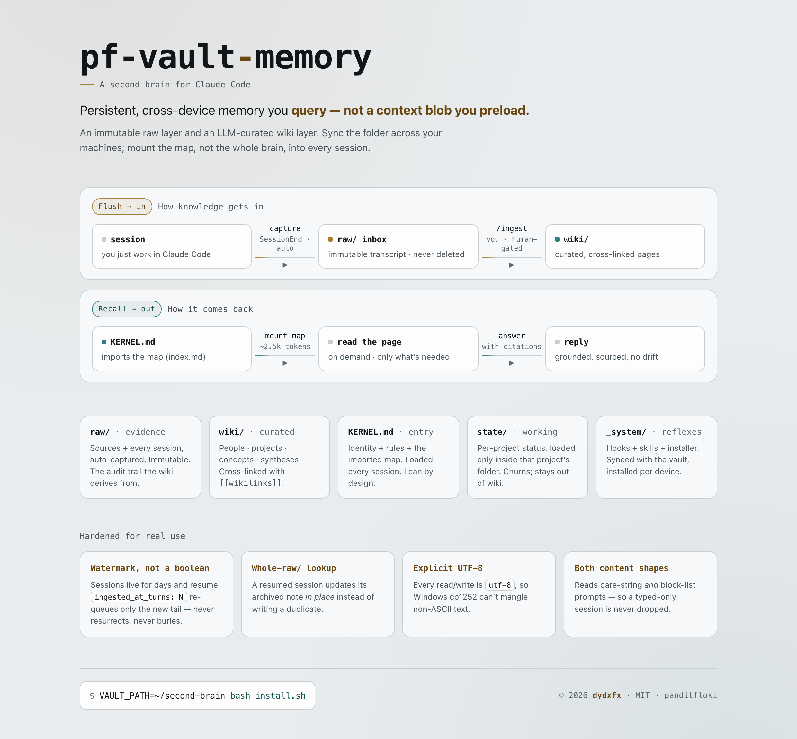

# pf-vault-memory

 &nbsp; &nbsp;

**A persistent, cross-device second brain for Claude Code and Codex — an LLM-maintained wiki you *query*, not a context blob you preload.**

<p align="center">
  <picture>
    <source media="(prefers-color-scheme: dark)" srcset="docs/architecture-dark.png">
    
  </picture>
</p>

Most "memory for Claude" setups append everything into one file or a vector store, then dump it
back into context. That loses provenance, drifts silently, and buries the one page that mattered.
pf-vault-memory borrows the LLM-wiki pattern: keep an **immutable raw layer** and a **curated
wiki layer**, sync the folder across your devices, and **mount the map, not the whole brain**
into each session.

## Why it's different

| Most memory skills | pf-vault-memory |
|---|---|
| Append to one flat file / vector DB | Immutable `raw/` + curated `wiki/` — full provenance, nothing deleted |
| Preload everything into context | Load the **map** (`index.md`), read the page **on demand** |
| Auto-synthesise, drift silently | Synthesis (`/ingest`) is **human-gated**; capture is automatic |
| Overwrite on change | Contradictions are **flagged, not overwritten** (`⚠️ superseded by …`) |
| Single machine | Folder syncs across every device; a per-device installer wires the reflexes |

## How it works

Five layers, two loops.

- **`raw/`** — immutable evidence: sources you drop in + every session auto-captured. Never edited,
  never deleted. `wiki/` is a derivative of it, so `raw/` is the audit trail.
- **`wiki/`** — the LLM-curated pages (people / projects / concepts / syntheses / sources),
  cross-linked with `[[wikilinks]]`.
- **`KERNEL.md`** — the single entry point loaded into every session. Identity + rules + the
  imported map (`wiki/index.md`). Lean by design.
- **`state/`** — per-project working state, loaded only inside that project's folder.
- **`_system/`** — the hooks + skills + installer that carry it.

**Flush loop** (knowledge in): a **SessionEnd** hook captures every session to `raw/inbox/`
(the hard guarantee) → you run **`/ingest`** to promote the durable parts into `wiki/`, with you
in the loop. **Recall loop** (knowledge out): `KERNEL.md` mounts the map; Claude reads the exact
page it needs on demand — never the whole vault.

A **SessionStart** hook reports two things and then stays quiet: unprocessed captures waiting, and
**installer drift** (a hook/skill the synced vault carries but this machine hasn't installed).

### The engineering that makes it survive real use

- **Watermark, not a boolean.** Sessions live for days and get resumed; the capture hook rewrites
  its note whole. A naive `status` flag either *resurrects* already-ingested notes or *buries* a
  resumed session's new turns. `ingested_at_turns: N` fixes both — re-queue only when
  `turns > N`.
- **Whole-`raw/` lookup.** After ingest, notes are filed to `raw/<year>/`. The hook searches all
  of `raw/` (not just the inbox) so a resumed session updates its archived note **in place**
  instead of writing a duplicate.
- **Explicit UTF-8.** On Windows, Python defaults to cp1252 and mangles any non-ASCII text. Every
  read/write is `encoding="utf-8"`.
- **Both content shapes.** Claude Code stores a typed prompt as a bare string and an
  attachment-bearing one as a block list. Reading only one shape silently drops turns.

## Install

```bash
# 1. clone
git clone https://github.com/panditfloki/pf-vault-memory && cd pf-vault-memory

# 2. install the reflexes on THIS machine (scaffolds the vault on first run)
VAULT_PATH=~/second-brain bash install.sh        # macOS / Linux
#   $env:VAULT_PATH="$HOME\second-brain"; ./install.ps1   # Windows

# 3. the one manual step it prints — add to ~/.claude/CLAUDE.md:
#    @~/second-brain/KERNEL.md

# 4. Windows Codex support (after install.ps1)
#    ./install-codex.ps1
#    Then open Codex, run /hooks once, trust the SessionEnd hook, and restart Codex.
```

Then **sync the vault folder** however you like (git, Dropbox, Syncthing, Obsidian Sync, iCloud),
and run `install.sh` once on each other device. The vault syncs; the reflexes are installed
per-machine — that split is deliberate.

## Use

- Just work. Claude Code and Codex sessions auto-capture on exit.
- `/capture` — save a decision or analysis mid-session, in your words.
- `/ingest` — promote the inbox into the wiki (you run this; it's never automatic).
- `/newproject` — wire a new project folder into the vault: a working-state file in the vault plus three tiny pointers in the project folder (`CLAUDE.md`, `AGENTS.md`, `GEMINI.md`), so that project's context loads automatically inside its folder in Claude Code, Codex, and Gemini/Antigravity alike.
- Ask normally — "what did we decide about X?" — and Claude reads the map, then the page.

## Layout

```
pf-vault-memory/
├── SKILL.md              # how Claude operates the system
├── install.sh / .ps1     # Claude Code per-device installer (idempotent)
├── install-codex.ps1     # Windows Codex skills + AGENTS.md + SessionEnd capture
├── codex-AGENTS.md.tmpl  # rendered into the user's Codex home per device
├── hooks/                # vault_capture.py (SessionEnd) · vault_queue_nudge.py (SessionStart)
├── skills/               # capture/ · ingest/ · newproject/
└── vault-template/       # CLAUDE.md (schema) · KERNEL.md (identity) · wiki/ scaffold
```

## Requirements

Claude Code and/or Codex · Python 3.9+ · any file-sync tool for multi-device (optional for single-machine).

## License

MIT — see [LICENSE](LICENSE).

---

<sub>© 2026 dydxfx · [dydxfx.com](https://dydxfx.com) · by Pandit Floki (`panditfloki`)</sub>
